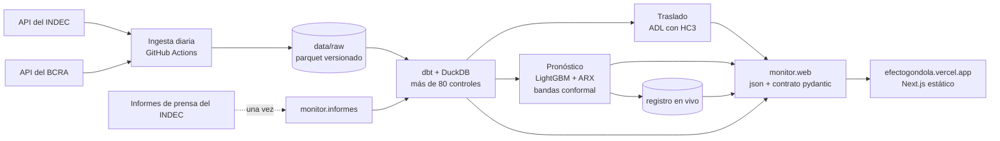

# Monitor de Traslado

Cuando sube el precio mayorista de algo, ¿cuánto de esa suba llega a la góndola y en cuántos meses? Este proyecto lo mide por rubro y por región con datos de la [API del INDEC](https://api.indec.gob.ar/), y pronostica el mes que viene sumando el dólar y las expectativas de inflación de la [API del BCRA](https://www.bcra.gob.ar/apis-banco-central/). De paso guarda cada versión de los datos, algo que la API no hace, para ver si el INDEC corrige lo que publica (hasta ahora no corrigió nada, ver [Revisiones](#revisiones)).

En LinkedIn lo vengo contando como **Efecto Góndola**, y así se llama la página: [efectogondola.vercel.app](https://efectogondola.vercel.app/).

## Estado

- [x] Fase 0: base del repo (uv, ruff, pytest, CI)
- [x] Fase 1: ingesta diaria con los crudos versionados
- [x] Fase 2: warehouse con dbt y DuckDB
- [x] Fase 3: análisis exploratorio
- [x] Fase 4: modelo de traslado
- [x] Fase 5: pronóstico
- [x] Fase 6: análisis de las revisiones
- [x] Fase 7: web con mapa por regiones
- [x] Fase 8: [metodología](docs/metodologia.md) y [model card](docs/model_card.md)

## Cómo funciona



Todos los días la ingesta trae lo nuevo, dbt arma la base y, cuando ya salió el mayorista del mes, corren los modelos. Si cambió algo, se regeneran los datos de la página y Vercel la publica de nuevo. El detalle está en la [metodología](docs/metodologia.md) y los límites del pronóstico en el [model card](docs/model_card.md).

## Correrlo

Hace falta [uv](https://docs.astral.sh/uv/) y un token de la API del INDEC (es gratis, se saca registrándose en la página). La del BCRA no pide token.

```
uv sync
cp .env.example .env      # pegar el token
uv run pytest
```

## Ingesta

Un workflow de GitHub Actions baja todos los días los últimos 6 meses del IPC y de los precios mayoristas, que es donde el INDEC corrige, y del BCRA el dólar mayorista (com. A 3500) y la mediana del REM. Una vez por mes baja toda la historia.

- `src/monitor/cliente.py`: un cliente para cada API con los mismos reintentos (429 o 5xx). Pagina siempre con el mismo orden y antes de bajar cuenta cuántas filas tendrían que llegar. Si no llegan todas, no guarda nada.
- `src/monitor/validacion.py`: chequea columnas, tipos, períodos y que no haya filas repetidas (con pandera). Si algo importante cambia, frena. Si aparece una columna o un valor nuevo, solo avisa.
- `src/monitor/almacenamiento.py`: saca un hash del contenido y solo guarda una versión nueva si cambió algo. Las versiones quedan en `data/raw/` en parquet y anotadas en `data/raw/manifest.csv`.

Para probarla sin tocar `data/raw`:

```
uv run python -m monitor.ingesta --modo reciente --salida data/prueba
```

## Warehouse

dbt lee los parquet de `data/raw` con DuckDB y arma tres capas:

- **staging**: limpia lo que viene de la API. El INDEC no siempre escribe igual las categorías ("Estacional" y "Estacionales", "NIVEL GENERAL" y "Nivel general", con y sin tildes), así que se normalizan. También marca los datos que el INDEC no pudo relevar (`///`), como restaurantes en la cuarentena de 2020. Hay un modelo con todas las versiones y otro con la última de cada dato.
- **intermediate**: todos los índices en el mismo formato, con la variación mensual y la logarítmica.
- **marts**: `fct_precios` (cada rubro en cada etapa: productor, industria y góndola por región), `fct_revisiones` (cada dato que el INDEC corrigió), `fct_bcra_mensual` (dólar y REM por mes), `fct_publicaciones` (cuándo salió cada dato), `dim_rubro`, `dim_region` y `dim_provincia`.

Los tests chequean claves únicas, valores, relaciones entre tablas, que la variación que calculo dé igual que la del INDEC (con 0.1 de margen por redondeo), que no falten meses y que la ingesta esté al día. Hay tests unitarios con datos inventados para la lógica de revisiones y de normalización.

```
cd dbt
uv run dbt build
uv run dbt docs generate && uv run dbt docs serve
```

Energía está solo como contraste: la tarifa es regulada, así que no es traslado de mercado.

## Análisis exploratorio

En [`notebooks/01_eda.ipynb`](notebooks/01_eda.ipynb). Lo principal:

- Hay tres etapas de inflación bien distintas (cerca del 2% mensual, entre 3 y 4%, y muy alta en 2022-2024), así que el traslado se va a estimar por etapa.
- Las series no son estacionarias en niveles y sí en variaciones: se trabaja con variaciones logarítmicas.
- Si se comparan las variaciones tal cual, mayorista y góndola parecen moverse casi igual en todos los rubros. Es la inflación general moviendo todo junto. Restándola, combustibles, tabaco y carnes siguen mostrando un traslado claro y rápido; en equipamiento del hogar, prendas y calzado llega con 1 o 2 meses de rezago.
- Solo verduras, frutas y prendas tienen estacionalidad fuerte.

Las funciones están en `src/monitor/analisis.py`; el notebook solo las usa.

## Modelo de traslado

En [`notebooks/02_traslado.ipynb`](notebooks/02_traslado.ipynb), con el código en `src/monitor/traslado.py`. Para cada rubro y región, un modelo de rezagos distribuidos sobre precios relativos (a cada serie le resto su inflación general): el mayorista de este mes y de los 3 anteriores, y 2 meses de la propia góndola. Errores HC3 y corrección por comparaciones múltiples. Para carnes, lácteos y pan hay además un VAR con la cadena completa: productor, industria y góndola.

Los rezagos son fijos a propósito. Con series simuladas de traslado conocido, elegirlos por BIC y estimar con los mismos datos daba intervalos del 95% que cubrían 84% y, con traslado cero, 16% de falsos positivos. Con rezagos fijos y HC3 cubren 95% y se equivocan 5% (hay un test que lo controla).

Lo que sale (GBA, datos a oct-2026):

- La mayor parte de una suba mayorista llega en el mismo mes (60% en la mediana) y el resto en los 3 meses siguientes.
- Carnes y prendas trasladan más de 0.8, combustibles y equipamiento del hogar 0.6. Lácteos, aceites, pan y bebidas no se distinguen de cero.
- De 132 estimaciones, 75 son significativas después de corregir por comparaciones múltiples.
- Con inflación alta se traslada más en 10 de 17 rubros.
- Entre regiones cambia poco, salvo combustibles (bastante menos en el Noreste y Patagonia) y autos.
- Con el IPIB en vez del IPIM da lo mismo, salvo tabaco y combustibles, que tienen impuestos pesados.

Es un modelo de asociación, no causal. Los resultados quedan en `data/resultados/`:

```
uv run python -m monitor.traslado
```

## Pronóstico

En [`notebooks/03_pronostico.ipynb`](notebooks/03_pronostico.ipynb), con el código en `src/monitor/pronostico.py`. Pronostica la inflación del mes que viene para cada rubro y región, y el nivel general de cada región.

**Cuándo y con qué.** El pronóstico se hace cuando sale el mayorista del mes anterior (desde 2018, entre el 14 y el 23). Para ese momento se sabe el IPC y el mayorista del mes anterior, el REM de fin de mes y el dólar de los días anteriores a esa publicación, que salen del calendario real del INDEC. No usa nada más.

**Modelo.** El promedio de dos:

- un LightGBM global (un solo modelo para las 120 series: 114 de rubros y 6 de nivel general, con rubro y región como variables), que capta relaciones no lineales;
- una regresión lineal por serie (ARX), que a diferencia de los árboles puede extrapolar un salto del dólar que nunca vio, como el de diciembre de 2023.

Mitad y mitad, sin ajustar pesos, para no sobreajustar.

**Validación.** Origen móvil sobre 36 meses: cada mes se entrena solo con lo anterior. Las decisiones las tomé mirando nov-23 a oct-25. El último año quedó guardado como prueba final y se miró una sola vez.

| MAE (pp de inflación mensual) | naive | ARX | LightGBM sin BCRA | LightGBM | combinado |
|---|---|---|---|---|---|
| 36 meses | 2.88 | 2.48 | | 2.32 | **2.24** |
| desarrollo (nov-23 a oct-25) | 3.46 | 2.95 | 3.01 | 2.77 | **2.65** |
| prueba final (nov-25 a oct-26) | 1.72 | 1.53 | 1.42 | 1.40 | 1.42 |

La tabla es solo de los rubros; el nivel general va aparte, más abajo.

- El combinado le gana al naive por un 22% y la diferencia es significativa (Diebold-Mariano, p = 0.001).
- El dólar y el REM mejoran los meses con shock (dic-23 a 2024) y no cambian nada en los tranquilos: en la prueba final, un año calmo, casi empatan. Es un seguro, no una mejora en todos los meses. La evidencia de la mejora sale del tramo donde tomé las decisiones, así que puede estar algo inflada.
- Dos bandas, de 80% y 90%, que salen de cuantiles de LightGBM calibrados con conformal por rubro y se agrandan cuando el dólar se mueve a principio de mes. Cubren 80% y 90% en total. En dic-2023 la del 80% pasó de cubrir 36% a 50% gracias al dólar, sin ensanchar los meses tranquilos (en 2026 miden 4.6 y 6.2 pp).
- Lo que más pesa es el REM y después el mayorista del mes anterior. La región casi no aporta.
- Los saltos grandes de verduras (clima, cosecha) quedan fuera del intervalo igual.
- **Nivel general.** Entra como una serie más por región, con el IPIM general como mayorista, para que la web tenga un pronóstico de la inflación de cada región. En los 36 meses erra 1.02 pp contra 1.34 del naive, pero la diferencia no es significativa (p = 0.16) y en la prueba final pierde: 0.59 contra 0.37. Con la inflación quieta, repetir el dato del mes pasado es muy difícil de mejorar. No lo corregí mirando la prueba final; la web muestra los dos para que se vea.

El MASE da arriba de 1 para casi todos, porque la escala sale de años con menos inflación. Por eso la comparación va contra el naive del mismo período.

```
uv run python -m monitor.pronostico
```

## Revisiones

En [`notebooks/04_revisiones.ipynb`](notebooks/04_revisiones.ipynb). La API solo tiene el dato vigente, así que para ver cuánto corrige el INDEC reconstruí la historia con los informes de prensa, que quedan online tal como salieron:

```
uv run python -m monitor.informes bajar      # listado y pdf del mayorista y del ipc
uv run python -m monitor.informes procesar   # saca la variacion mensual de cada pdf
```

Los PDF no se suben al repo (pesan 250 MB). La ingesta diaria corre `informes calendario`, que suma solo las fechas de publicación nuevas, sin bajar PDF. Se suben el listado, con el hash de cada PDF, y lo que se sacó de ellos (`data/informes/`). En dbt, `fct_primer_dato` cruza cada primer dato con el valor de hoy en la API.

- En más de 20 mil datos (IPC desde 2017, mayorista desde 2018, por división y región), el INDEC no corrigió ninguna variación mensual al decimal que publica. El "provisorio" del mayorista nunca cambió.
- Por eso el backtest del pronóstico no está sesgado por usar datos ya revisados.
- Restaurantes de abril a julio de 2020 tiene la variación del nivel general: se imputó porque estaban cerrados y nunca se reemplazó.
- El mayorista se publica entre el 14 y el 23. Con ese calendario encontré una filtración chica en el pronóstico (usaba el dólar hasta el 15 y 4 meses salió antes): ahora el corte sale de la fecha real.

La ingesta sigue guardando cada versión, así que si el INDEC corrige algo de acá en adelante va a aparecer en `fct_revisiones`.

## Corrida mensual

`.github/workflows/modelo.yml` corre después de cada ingesta. Casi todos los días termina enseguida porque no hay nada nuevo. Cuando ya salieron el IPC y el mayorista del mes y hay dólar hasta el 13, actualiza el warehouse, corre el traslado y el pronóstico, y guarda el pronóstico en `data/resultados/registro_pronosticos.csv`. Después, todos los días, regenera los datos de la web (`data/web`); si cambiaron, los sube y Vercel vuelve a publicar la página.

Ese registro no se pisa: es lo que el modelo dijo en su momento, con la versión de los datos y del modelo que usó. Si se suma una serie nueva (como el nivel general), entran solo las filas que no estaban. Cuando el INDEC publica el dato se puede medir el error real, no el de un backtest con datos ya revisados.

Todo junto tarda menos de un minuto. El backtest reparte los meses entre los núcleos que haya.

```
uv run python -m monitor.mensual
```

## Web

La página pública se llama Efecto Góndola. Es un sitio estático en Next.js (`web/`), sin servidor ni base de datos.

- **Datos.** `monitor.web` arma cuatro JSON en `data/web` a partir del warehouse y de `data/resultados`. El resumen (unos 55 KB) va dentro de la página; series, backtest e historial (registro en vivo y calendario) los baja el navegador después, y los dos últimos recién cuando se llega a esa parte. Así la primera carga pesa la mitad. El contrato son los modelos de pydantic de `src/monitor/web.py`: de ahí sale `data/web/esquema.json` y de ese esquema, los tipos de TypeScript (`web/lib/tipos.ts`). Si el contrato cambia y los tipos no, falla el CI.
- **Mapa.** Regiones del IPC con límites del IGN (SIG 250, vía CONAE), en GeoJSON por [mgaitan/departamentos_argentina](https://github.com/mgaitan/departamentos_argentina). GBA es la ciudad más los 24 partidos del conurbano; el resto de Buenos Aires va en Pampeana. Se simplifica con mapshaper (`npm run geo`) y se dibuja en el build con d3-geo: al navegador llegan solo los trazos.
- **Gráficos.** Observable Plot. El pronóstico va en gris tinta, nunca en el color de una región. Energía siempre en gris pizarra punteado y con la aclaración de tarifa regulada.
- **Publicación.** [efectogondola.vercel.app](https://efectogondola.vercel.app/), en Vercel con raíz en `web/`. Solo hace build si cambió algo en `web/` o en `data/web` desde el último deploy (`web/vercel.json`).
- **Cualquier mes.** El panel de cada región tiene un selector de mes desde enero de 2017, que también cambia la lista de regiones debajo del mapa. Se puede compartir un mes con el link: `efectogondola.vercel.app/?mes=2023-12`. La franja de arriba y el pronóstico siempre muestran lo último.
- **Entre un mes y otro.** Cuando sale el IPC del mes pronosticado y todavía no el mayorista, el pronóstico que hay ya es viejo: la página lo muestra como "dijo y fue" y avisa cuándo sale el siguiente.

```
uv run python -m monitor.web   # regenera data/web
cd web
npm install
npm run dev                     # http://localhost:3000
npm run tipos                   # tipos desde el esquema
npm run build                   # sitio estatico en web/out
```

## Carpetas

```
src/monitor/   el pipeline
scripts/       la exploracion inicial de la API
notebooks/     analisis
dbt/           modelos, seeds y tests
data/raw/      crudos versionados
data/resultados/  resultados del modelo
data/informes/ listado y primeros datos de los informes del indec
data/web/      los json que lee la pagina
web/           la pagina (Next.js estatico)
tests/         tests de python
docs/          metodologia y model card
PRODUCT.md     para quien es la pagina y que tiene que lograr
DESIGN.md      el sistema visual de la pagina (colores, letras, graficos)
```

## Datos

- IPC (`ipc_nacional`): desde abril de 2016, 6 regiones más el total nacional.
- Precios mayoristas (`sipm_precios_mayoristas`): desde diciembre de 2015, total del país.
- BCRA, principales variables: dólar mayorista de referencia (variable 5, diario) y mediana del REM a 12 meses (variable 29, mensual desde junio de 2016).
- Informes técnicos del INDEC (PDF): el primer dato publicado y la fecha de publicación de cada mes.

El INDEC no publica precios por provincia, por eso todo va por región.

Fuentes: INDEC y BCRA. Límites del mapa: Instituto Geográfico Nacional (SIG 250, vía CONAE), convertidos por [mgaitan/departamentos_argentina](https://github.com/mgaitan/departamentos_argentina).
